# ARCHITECTURE — Distributed Wagering Processor

Este documento explica **como** o serviço garante as invariantes financeiras e **por que** cada decisão foi tomada. Ordem de autoridade usada em conflitos:

1. Enunciado do desafio
2. Guia de execução v4 (decisões D1–D8)
3. `docs/001_initial_schema.sql` (aplicado verbatim pela migration)

Invariantes globais: **não duplicar crédito, não duplicar débito, não perder evento confirmado, nunca saldo negativo** e, em todo cenário, `wallet.balance == saldo reconstruído pelo ledger`.

---

## 1. Fluxo ponta a ponta

```mermaid
flowchart LR
  subgraph Entradas
    HTTP["POST /wagering/transactions<br/>(Idempotency-Key)"]
    Q[("wager-transactions.fifo")]
  end
  HTTP --> UC
  Q -->|long polling| CONS["Consumidor SQS"] --> UC
  UC["SubmitWagerTransactionUseCase<br/>(o mesmo para HTTP e SQS)"]

  subgraph TX["1 transação SQL (tudo ou nada)"]
    L1["SELECT wallet FOR UPDATE"] --> IN["inbox: INSERT ON CONFLICT DO NOTHING<br/>(só SQS)"]
    IN --> ID["idempotência: (provider,key) / (provider,externalId)<br/>replay ou 409"]
    ID --> REF["referência FOR UPDATE<br/>(wallet → referência)"]
    REF --> RULES["regras puras de domínio (settle)"]
    RULES --> INS["wager_transactions: INSERT ON CONFLICT DO NOTHING"]
    INS --> W["UPDATE wallets (saldo, version)"]
    W --> LED["INSERT wallet_ledger_entries (append-only)"]
    LED --> OB["INSERT outbox_messages"]
  end
  UC --> TX
  TX -->|COMMIT| ACK["ack SQS (DeleteMessage)<br/>só depois do commit"]
  TX -->|COMMIT| RESP["resposta HTTP 201/200/202/422"]

  OB -.-> OW["Worker da outbox<br/>FOR UPDATE SKIP LOCKED"]
  OW -->|eventId = dedup id| EV[("wager-events.fifo")]
  EV --> EC["Consumidores externos<br/>(deduplicam por eventId)"]

  CONS -->|erro permanente| DLQ[("wager-transactions-dlq.fifo")]
  Q -.->|redrive maxReceiveCount=5| DLQ
  PW["Worker PENDING_REFERENCE<br/>backoff + TTL"] --> UC2["reprocessa sob lock da wallet"]
```

Componentes (por camada — DDD, guia §13):

| Camada         | Pasta                                   | Conteúdo                                                                                                                                                                                                                       | Depende de                                                  |
| -------------- | --------------------------------------- | ------------------------------------------------------------------------------------------------------------------------------------------------------------------------------------------------------------------------------ | ----------------------------------------------------------- |
| Domínio        | `src/domain`                            | `Money`, `Wallet`, `WalletLedgerEntry`, `WagerTransaction` (máquina de estados), regras puras (`wager-settlement`), `FailureCode`, `IntegrationEvent` e subclasses, `InboxMessage`, `OutboxMessage`, JSON canônico/payloadHash | nada (sem NestJS, sem ORM; só `decimal.js` e `node:crypto`) |
| Aplicação      | `src/application`                       | use cases (criar wallet, submeter transação, publicar outbox, PENDING_REFERENCE, reconciliação, consultas), portas (`UnitOfWork`, repositórios, `EventPublisherPort`, `ProviderIdentityPort`, `Clock`, `IdGenerator`)          | domínio                                                     |
| Infraestrutura | `src/infrastructure`                    | MikroORM (EntitySchema, mappers, repositórios, UoW), SQS (publisher, consumidor), workers, config                                                                                                                              | aplicação, domínio                                          |
| Interfaces     | `src/interfaces`                        | controllers HTTP, filtro de exceção único, `AuthGuard` no-op, parsers de contrato HTTP/SQS                                                                                                                                     | aplicação                                                   |
| Composição     | `src/container.ts`, `src/app.module.ts` | monta o grafo; NestJS recebe instâncias prontas                                                                                                                                                                                | tudo                                                        |

Um teste de arquitetura (`test/unit/architecture.test.ts`) falha se o domínio importar NestJS, MikroORM, AWS SDK ou `pg`, ou se existir conversão de dinheiro para `number`.

---

## 1.1 Máquina de estados da WagerTransaction

| De                                  | Para                                | Quando                                                                                                   |
| ----------------------------------- | ----------------------------------- | -------------------------------------------------------------------------------------------------------- |
| —                                   | `PENDING`                           | `create` (provedor) ou `opening` (interno; OPENING nunca é submetível)                                   |
| `PENDING`                           | `PROCESSED`                         | regra aplicada (inclusive LOSS, sem lançamento)                                                          |
| `PENDING`                           | `REJECTED`                          | violação de regra de negócio (código de categoria BUSINESS)                                              |
| `PENDING`                           | `PENDING_REFERENCE`                 | REFUND/ROLLBACK (ou WIN com referência informada — E2) cuja referência não existe ou ainda está pendente |
| `PENDING`                           | `FAILED`                            | erro permanente inesperado (código de categoria PERMANENT), gravado em transação própria                 |
| `PENDING_REFERENCE`                 | `PENDING_REFERENCE`                 | worker: referência ainda ausente → `attempts + 1`, novo `next_attempt_at` (backoff)                      |
| `PENDING_REFERENCE`                 | `PROCESSED` / `REJECTED` / `FAILED` | referência chegou e a regra foi aplicada/violada; ou TTL/limite esgotado (`REFERENCE_NOT_FOUND`)         |
| `PROCESSED` / `REJECTED` / `FAILED` | —                                   | terminais: qualquer transição lança `InvalidTransactionStateError` (erro de programação)                 |

Testada transição a transição em `test/unit/wager-transaction.test.ts`. O banco reforça os invariantes de estado: `ck_tx_failure_code` (REJECTED/FAILED ⇔ failure_code) e `ck_tx_processed_at` (PROCESSED ⇔ processed_at).

## 1.2 Adaptações de assinatura em relação aos esqueletos do enunciado

O enunciado permite adaptar nomes e assinaturas preservando as garantias (§6). As adaptações:

| Esqueleto                          | Implementação                                                                                             | Motivo                                                                                                                                             |
| ---------------------------------- | --------------------------------------------------------------------------------------------------------- | -------------------------------------------------------------------------------------------------------------------------------------------------- |
| `Wallet.open(props): Wallet`       | `Wallet.open(props): { wallet, openingEntry }` (recebe também os ids da OPENING e do lançamento e a data) | o saldo inicial é uma alteração de saldo: o lançamento CREDIT nasce junto, e a wallet continua com `version = 1`                                   |
| `debit()/credit()`                 | `debit/credit({ entryId, transactionId, money, at }): WalletLedgerEntry` + `canDebit(money)`              | devolvem o lançamento correspondente (saldo e ledger nunca divergem); `canDebit` permite escolher `INSUFFICIENT_FUNDS` × `REVERSAL_WOULD_OVERDRAW` |
| —                                  | `Wallet.canCredit(money)` + `Money.canAdd(other)`                                                         | consultas sem efeito colateral que permitem rejeitar `BALANCE_LIMIT_EXCEEDED` (E14) em vez de deixar a escrita falhar                              |
| `markProcessed(refId, at)`         | `markProcessed({ referenceTransactionId, observedBalance, at })`                                          | grava o saldo observado que o replay devolve (regra 7)                                                                                             |
| `markPendingReference()`           | `markPendingReference(schedule, at)` + `scheduleReferenceRetry(next, at)`                                 | a agenda de backoff/TTL faz parte do estado persistido                                                                                             |
| `reject(code)` / `fail(code)`      | `reject(code, { observedBalance, at, referenceTransactionId? })` / `fail(code, { observedBalance, at })`  | saldo observado e referência resolvida ficam auditáveis                                                                                            |
| `Money.from`                       | `Money.from` (aceita sinal, uso interno) + `Money.fromInput` (contratos de entrada, recusa negativos)     | o enunciado proíbe negativos **em contratos de entrada**, mas `negate()` e a diferença da reconciliação precisam de valores negativos              |
| `OutboxMessage.scheduleRetry(now)` | `scheduleRetry(now, error?, policy?)`                                                                     | guarda `last_error` e permite configurar o teto de backoff                                                                                         |
| `WalletLedgerEntry`                | + `signedAmount()` (consulta)                                                                             | usada na reconciliação; continua sem campos mutáveis nem transições                                                                                |

## 2. Dinheiro e ORM

**ORM: MikroORM 7** (preferencial no enunciado). Motivos: Unit of Work e Identity Map explícitos, `EntityManager.transactional()`, `LockMode.PESSIMISTIC_WRITE` / `PESSIMISTIC_PARTIAL_WRITE` (SKIP LOCKED) e QueryBuilder com `onConflict().ignore()`. Tudo o que a solução precisa, sem SQL espalhado.

- **Domínio puro.** Entidades de persistência são `EntitySchema` (sem decorators — o Bun não emite `emitDecoratorMetadata`) em `records.ts`; `mappers.ts` converte record ↔ domínio. `rehydrate` reconstrói estado sem revalidar transições.
- **Money (Restrição #1).** Value object imutável sobre `decimal.js`, escala fixa 2, limite de NUMERIC(18,2) verificado em toda operação. No banco: `NUMERIC(18,2)` + `CHAR(3)` em colunas separadas. O driver `pg` devolve NUMERIC como **string**; o mapper usa `DecimalType('string')` e reidrata com `Money.from({amount, currency})` — nunca passa por `number`. Contratos HTTP, mensagens e eventos usam sempre `MoneyProps` `{ "amount": "25.00", "currency": "BRL" }`.
- **Entrada:** aceita 0–2 casas e normaliza para 2 (sem arredondar); rejeita NaN, Infinity, notação científica, string vazia, `number`, mais de 2 casas, zeros à esquerda e negativos (`Money.fromInput`).
- **Schema:** gerado só pela migration (nunca pelo schema generator do ORM). `up()` aplica o UP de `docs/001_initial_schema.sql` **verbatim** (um teste compara o texto); `down()` executa o bloco DOWN.

---

## 3. Concorrência e locking

Unidade de concorrência: **`walletId`**.

| Estratégia                                                   | Como funciona                                           | Trade-off                                                                                            | Decisão                                                                     |
| ------------------------------------------------------------ | ------------------------------------------------------- | ---------------------------------------------------------------------------------------------------- | --------------------------------------------------------------------------- |
| **Lock pessimista** `SELECT … FOR UPDATE` na linha da wallet | trava antes de ler o saldo; mantém até o commit         | simples, determinístico; serializa só a mesma wallet                                                 | **adotada**                                                                 |
| Otimista (`version`)                                         | `UPDATE … WHERE version = ?` + retry                    | menos espera, mas retrabalho e starvation em wallet quente; replay/idempotência ficam mais complexos | descartada                                                                  |
| Update atômico condicionado                                  | `UPDATE … SET balance = balance - v WHERE balance >= v` | uma instrução, mas não grava transação/ledger/outbox sob a mesma garantia                            | complemento: o `CHECK (balance >= 0)` faz esse papel como rede de segurança |

Regras:

- **Restrição #7:** todo fluxo que altera saldo começa com `lockById` (`PESSIMISTIC_WRITE` + `refresh`) — o saldo é lido **depois** do lock.
- **Restrição #6:** o lock é só da linha da wallet; wallets diferentes nunca se bloqueiam (teste com wallet travada por outra conexão enquanto 100 operações em outras wallets concluem).
- **Ordem fixa** wallet → linha da referência em todos os fluxos (submissão, worker de pendências): sem ciclo de espera, sem deadlock.
- **Transações curtas:** nenhuma chamada de rede com o lock da wallet seguro. `SET LOCAL lock_timeout` (padrão 5 s): espera além disso → `55P03` → erro **transitório** (503 / retry), contado em `wager_lock_conflicts_total`. Deadlock `40P01` idem.
- **`version`** começa em 1 e só incrementa quando o saldo muda; não é usada para controle de concorrência (o lock pessimista é a garantia), mas fica no contrato e no evento `WalletBalanceChanged.walletVersion` para ordenação no consumidor.
- **Restrição #8:** nada de estado em memória: locks no banco, outbox com SKIP LOCKED, inbox com ON CONFLICT, claim de pendências com SKIP LOCKED + lease. Provado com 3 processos reais.

---

## 4. Idempotência

**Persistente (Restrição #2):** `UNIQUE (provider_id, external_transaction_id)` e `UNIQUE (provider_id, idempotency_key)` (D5) no banco; inbox em tabela. Nenhum cache em memória.

Fluxo (guia §6.2), dentro da transação e **depois** do lock da wallet:

1. Procura por `(provider, key)` **ou** `(provider, externalId)`:
   - mesma key + mesmo externalId + mesmo `payloadHash` → **replay**: devolve o **resultado original** (status, failureCode e `observed_balance` gravado quando ficou terminal), com `idempotentReplay: true`;
   - mesma key com payload diferente, ou mesmo externalId com key diferente → **409** (erro do provedor, não replay).
2. Senão aplica as regras e faz `INSERT … ON CONFLICT DO NOTHING`. Se voltar **0 linhas** (corrida com a mesma key em _outra_ wallet, que trava outra linha), relê a linha existente e compara o hash. No PostgreSQL um erro de UNIQUE abortaria a transação inteira; o `DO NOTHING` espera o desfecho da transação concorrente e devolve 0 linhas sem abortar.
3. Replay por status: PROCESSED → **200**; REJECTED → **o mesmo 422**; PENDING_REFERENCE → **202** com saldo atual (D6); FAILED → o mesmo **500** (E5).

**payloadHash** = `SHA-256` (hex) do **JSON canônico** do subconjunto de negócio:
`providerId, externalTransactionId, playerId, walletId, roundId, gameId, kind, money { amount, currency }, referenceExternalTransactionId` (só se presente).

- Canonização: chaves ordenadas recursivamente pela ordem de code unit UTF-16 (`Array.prototype.sort`), sem espaços, propriedades `undefined` omitidas, UTF-8; `amount` sempre com 2 casas (`"25"` e `"25.00"` → mesmo hash).
- **Fora do hash:** header `Idempotency-Key`, `messageId`, `occurredAt`, `correlationId` e qualquer metadado de transporte — a mesma operação por HTTP ou SQS tem o mesmo hash.
- Vetor de referência em `test/unit/payload-hash.test.ts`.

A inbox usa um hash próprio do conteúdo da mensagem (`{type, data}` normalizado): mesmo `messageId` com conteúdo diferente = conflito → DLQ.

---

## 5. Transactional Outbox e Inbox

- **Atomicidade (enunciado §11):** inbox, transação, saldo, lançamento e evento na **mesma transação SQL**. Provado com falha real injetada na última escrita (outbox): débito, lançamento e inbox são desfeitos (`test/integration/atomicity.test.ts`).
- **Restrição #4:** só o worker publica, e só lê linhas comitadas. Nenhum outro código chama o SQS de eventos.
- **Publishers concorrentes:** lote com `FOR UPDATE SKIP LOCKED` → cada linha com no máximo um publisher por vez; os locks seguros durante a chamada ao SQS são **das linhas da outbox**, nunca da wallet.
- **Nunca perde:** falha → `scheduleRetry` (backoff 1 s × 2, teto 5 min, configurável); depois de N tentativas uma métrica sinaliza (`outbox_overdue_total`), mas o evento continua pendente.
- **Crash entre publicar e marcar:** o rollback devolve a linha; outro publisher republica com o **mesmo eventId** (= `MessageDeduplicationId` no FIFO, janela de 5 min); fora da janela, o consumidor deduplica por `eventId`. Testado com publicação real seguida de "morte" antes do commit.
- **Fila separada (D8):** `wager-events.fifo`, `MessageGroupId = aggregateId (walletId)`.
- **Eventos:** `WagerTransactionProcessed` (inclusive LOSS e OPENING — D3), `WagerTransactionRejected` (inclusive expiração de PENDING_REFERENCE), `WalletBalanceChanged` (**só** quando há lançamento), `WagerTransactionPendingReference`. Envelope abstrato `IntegrationEvent<T>`; `eventType`/`version` ficam no tipo; `data` só com `MoneyProps`.
- **Inbox:** `PRIMARY KEY (consumer_name, message_id)`, `INSERT … ON CONFLICT DO NOTHING`, gravada já como processada **no mesmo commit** do efeito.

### 5.1 Garantias no banco além das constraints (Migration002)

- **Privilégio mínimo:** a app conecta com um login (`wagering_service` no compose) membro do role `wagering_app`, que **não é dono** das tabelas nem superusuário. Permissões: `SELECT/INSERT/UPDATE` em wallets, transações, inbox e outbox; **só `SELECT/INSERT`** no ledger; nada de `DELETE`/`TRUNCATE`. Sem ser dono, não consegue `DISABLE TRIGGER`/`DROP TRIGGER` — a imutabilidade não depende de convenção. O `migrate` (dono do schema) provisiona o login a partir de `DATABASE_APP_USER`/`DATABASE_APP_PASSWORD`.
- **Transações terminais imutáveis:** trigger `trg_tx_guard_update` recusa qualquer `UPDATE` em linha `PROCESSED/REJECTED/FAILED` (é dela que o replay devolve o resultado original) e qualquer mudança de identidade/payload (provider, ids, key, hash, wallet, player, rodada, jogo, kind, valor, moeda, referência) em qualquer estado. `DELETE`/`TRUNCATE` bloqueados. Vale até para o dono do schema.
- Testado em `test/integration/db-privileges.test.ts` (com `SET ROLE wagering_app`).
- Migrations futuras precisam de `GRANT` explícito para `wagering_app`. O `down` revoga as permissões do banco, mas não remove o role (é do cluster e pode servir a outros bancos).

---

## 6. Taxonomia de falhas e status HTTP

| Categoria                                                                                                      | Tratamento                                                                                                                                             |
| -------------------------------------------------------------------------------------------------------------- | ------------------------------------------------------------------------------------------------------------------------------------------------------ |
| Negócio                                                                                                        | `REJECTED` + `failureCode`, commit, ack. Resultado legítimo; nunca vai à DLQ. HTTP 422.                                                                |
| Transitório (deadlock, lock timeout, banco/SQS fora, recursos esgotados — classes `08`/`53`, `58030`, `25006`) | **Nunca persistido** (D7). HTTP 503 + `Retry-After`; fila: sem ack, `ChangeMessageVisibility` com backoff exponencial + jitter (base 5 s, teto 5 min). |
| Permanente sem linha possível (payload inválido, wallet inexistente)                                           | HTTP 400/404; fila: DLQ explícita + ack, sem linha (FK/NOT NULL impedem).                                                                              |
| Permanente com linha gravável (erro inesperado)                                                                | `FAILED` (`INTERNAL_PERMANENT_ERROR`) gravado em **transação própria** após o rollback; HTTP 500; fila: DLQ + ack.                                     |

| failureCode                | Resultado                         | Quando                                                                   | O provedor deve                  | HTTP      |
| -------------------------- | --------------------------------- | ------------------------------------------------------------------------ | -------------------------------- | --------- |
| `INSUFFICIENT_FUNDS`       | REJECTED                          | BET sem saldo                                                            | reenviar só com saldo / desistir | 422       |
| `REVERSAL_WOULD_OVERDRAW`  | REJECTED                          | reversão debitaria além do saldo (regra 9)                               | tratar como incidente            | 422       |
| `REFERENCE_NOT_FOUND`      | PENDING_REFERENCE → REJECTED      | referência ausente após TTL/limite                                       | corrigir a referência            | 202 → 422 |
| `REFERENCE_NOT_PROCESSED`  | REJECTED                          | referência terminou REJECTED/FAILED (D2)                                 | desistir                         | 422       |
| `REFERENCE_MISMATCH`       | REJECTED                          | provider/player/wallet/rodada diferentes                                 | corrigir                         | 422       |
| `REFERENCE_INVALID_KIND`   | REJECTED                          | kind não referenciável (REFUND→só BET; ROLLBACK→BET/WIN/REFUND; WIN→BET) | corrigir                         | 422       |
| `ALREADY_REVERSED`         | REJECTED                          | referência já revertida (D1)                                             | desistir                         | 422       |
| `AMOUNT_MISMATCH`          | REJECTED                          | valor ≠ valor da referência                                              | corrigir                         | 422       |
| `CURRENCY_MISMATCH`        | REJECTED                          | moeda ≠ wallet ou referência                                             | corrigir                         | 422       |
| `PLAYER_MISMATCH`          | REJECTED                          | playerId ≠ player da wallet                                              | corrigir                         | 422       |
| `BALANCE_LIMIT_EXCEEDED`   | REJECTED                          | crédito levaria o saldo além do limite de NUMERIC(18,2)                  | investigar                       | 422       |
| `INTERNAL_PERMANENT_ERROR` | FAILED                            | erro inesperado                                                          | abrir chamado                    | 500       |
| `RETRY_LIMIT_EXCEEDED`     | — (motivo de DLQ, não persistido) | tentativas da fila esgotadas por transitório (E4)                        | reenviar depois (mesma key)      | —         |

Não há códigos de duplicata (duplicata é replay) nem de transitório (não é persistido).

**Tabela HTTP (consistente em todos os endpoints)** — um teste HTTP real por linha em `test/integration/http-api.test.ts`:

| Situação                                                                                                                         | Status                         | Reenviar?                        |
| -------------------------------------------------------------------------------------------------------------------------------- | ------------------------------ | -------------------------------- |
| Processada (primeira vez)                                                                                                        | 201                            | não                              |
| Replay idêntico de processada                                                                                                    | 200 + `idempotentReplay: true` | não                              |
| PENDING_REFERENCE                                                                                                                | 202                            | não; consultar por GET           |
| Rejeição de negócio                                                                                                              | 422 (replay: o mesmo 422)      | conforme o código                |
| Payload inválido / header ausente / `idempotencyKey` do corpo ≠ header / cursor inválido                                         | 400                            | só após corrigir                 |
| Mesma key com payload diferente (inclusive outra wallet, existente ou não); mesmo externalId com key diferente; wallet duplicada | 409                            | não                              |
| Wallet/transação inexistente                                                                                                     | 404                            | só após corrigir                 |
| Principal não autorizado para o provedor (quando a autenticação existir)                                                         | 403                            | não                              |
| Corpo acima de 100 KB                                                                                                            | 413                            | só após corrigir                 |
| Falha permanente inesperada (FAILED)                                                                                             | 500                            | não sem investigação             |
| Falha transitória                                                                                                                | 503 + `Retry-After`            | sim, com a mesma Idempotency-Key |

Um único `HttpExceptionFilter` faz o mapeamento de exceções; 201/200/202/422/500-FAILED são resultados do use case.

---

## 7. Consumidor SQS

- Long polling; mesmo use case do HTTP; inbox por `(consumerName, messageId)`.
- **Ack somente após o commit.** O SQS não tem NACK: retry = não apagar + `ChangeMessageVisibility` (backoff + jitter).
- Limite de tentativas = `maxReceiveCount` da redrive (5), comparado com o `ApproximateReceiveCount`. O consumidor lê a `RedrivePolicy` da fila ao iniciar (`GetQueueAttributes`), para não divergir dela; `SQS_MAX_RECEIVE_COUNT` só vale enquanto a fila não pôde ser consultada ou se ela não tiver redrive. Divergência é logada como `warn`. Na última tentativa com erro transitório, envia à DLQ com `failureReason = RETRY_LIMIT_EXCEEDED` **sem gravar nada** (E4/D7); a operação pode ser reprocessada com a mesma key.
- DLQ explícita: envia à DLQ **antes** do ack (crash no meio → reenvio com o mesmo dedup id, o FIFO deduplica), com atributo `failureReason`.
- Mensagens do lote são processadas em sequência (o FIFO entrega em ordem por `MessageGroupId = walletId`); várias instâncias dividem os grupos. Se uma mensagem vai a retry, as seguintes do **mesmo grupo** no lote não são processadas: voltam à fila invisíveis por um pouco mais que o backoff dela, para não passarem na frente (testado).
- **SIGTERM:** para de buscar, conclui a mensagem em andamento (commit + ack) e devolve as não iniciadas (`VisibilityTimeout 0`). O long poll **não é abortado** (E11).
- **Restrição #3:** FIFO/dedup do SQS são otimização; testes enviam a mesma operação com dedup ids e messageIds diferentes e o banco garante um único efeito.

---

## 8. PENDING_REFERENCE

- Referência ausente ou ainda pendente → `PENDING_REFERENCE` (202) com `next_attempt_at`/`expires_at` e evento `WagerTransactionPendingReference`.
- **Gatilho imediato:** quando qualquer transação fica terminal, os dependentes que esperavam por ela são reprocessados após o commit (em cadeia: ROLLBACK→REFUND→BET).
- **Worker agendado** (rede de segurança): claim com `FOR UPDATE SKIP LOCKED` + lease de 30 s; reprocessa travando wallet → referência e relendo a transação sob o lock (idempotente entre instâncias).
- **Limites (configuráveis):** TTL 1 h, backoff 2 s × 2 com teto 5 min, 20 tentativas — o que vier primeiro. Provedores at-least-once reordenam em segundos/minutos; 1 h cobre atrasos realistas sem acumular pendências. Esgotado → `REJECTED REFERENCE_NOT_FOUND` + `WagerTransactionRejected`.

---

## 9. Reconciliação

`POST /wallets/:walletId/reconciliation` compara `wallets.balance` com a soma com sinal de todos os lançamentos (feita em NUMERIC no banco). Trava a wallet durante as duas leituras (em READ COMMITTED, um commit no meio geraria falsa divergência). **Nunca corrige:** divergência → log `error`, `reconciliation_divergence_total` e `consistent: false`. Teste com corrupção proposital do saldo no banco.

---

## 10. Observabilidade

- **Logs JSON** (uma linha por evento) com `correlationId`, `messageId`, `transactionId`, `walletId`, `providerId`, status, duração. Sem corpo de requisição/mensagem nem valores monetários (um teste verifica que nenhum log contém `"amount"`).
- **CorrelationId:** header `X-Correlation-Id` (ou gerado) → resposta → envelope dos eventos → log de publicação; no SQS, o `messageId` é o correlationId e o causationId. Teste ponta a ponta HTTP → transação → evento publicado.
- **Métricas** (`GET /metrics`, Prometheus): `wager_transactions_total{kind,status}`, `wager_duplicates_total`, `wager_retries_total`, `wager_dlq_messages_total{reason}`, `wager_lock_conflicts_total`, `wager_processing_duration_seconds{source}` (histograma), `outbox_pending_total`, `outbox_lag_seconds`, `outbox_overdue_total`, `reconciliation_divergence_total` + métricas padrão do processo. Pendentes e lag da outbox são amostrados por um laço próprio (`OUTBOX_METRICS_INTERVAL_MS`, padrão 5 s), fora do caminho de publicação: a contagem não roda depois de cada lote publicado.
- **Health:** `/health/live` (processo, sem dependências) e `/health/ready` (`SELECT 1` + SQS alcançável; 503 se algum cair). Abertos.

---

## 10.1 Contrato OpenAPI (Swagger)

- **Spec OpenAPI 3.1 escrito à mão** em `src/interfaces/http/openapi/openapi-document.ts`, servido em `/docs/openapi.json`, com Swagger UI em `/docs` (aberto, como health e métricas) e exportado em `docs/openapi.json`.
- **Por que à mão, e não com decorators do `@nestjs/swagger`:** a validação de entrada é manual sobre `unknown` (o Bun não emite metadata de tipos — E7), então a geração automática produziria quase nada. Além disso, o que importa ao provedor (replay devolvendo o mesmo 422, 202 com saldo atual, 503 com `Retry-After`, a taxonomia de `failureCode`) precisa ser descrito de qualquer forma. Os enums (`failureCode`, kinds, status) vêm do domínio, sem lista duplicada.
- **Sem drift:** `test/integration/openapi-contract.test.ts` sobe a app real e verifica:
  - o conjunto de rotas mapeadas pelo Nest é igual ao documentado;
  - cada resposta real tem um status documentado e corpo válido contra o schema (ajv, JSON Schema 2020-12);
  - todos os exemplos do spec são válidos;
  - o `docs/openapi.json` exportado está atualizado.

  Um teste de mutação (rota renomeada e tipo errado no spec) confirmou que ele falha quando há divergência.

- **UI sem CDN:** os assets vêm do pacote `swagger-ui-dist`, servidos a partir de uma lista fechada de arquivos (sem path traversal). Funciona offline e no container.

## 11. Autenticação (extensão, não implementada)

Decisão permitida pelo enunciado (§2): **não implementar**. Desenho que seria adotado:

- IdP externo (**Keycloak** ou **Zitadel**) no compose; cada provedor de jogos é um _client_ OIDC (client credentials).
- `AuthGuard` valida `Authorization: Bearer <JWT>` (assinatura via JWKS, `iss`, `aud`, `exp`) e anexa o `principal` (client_id). Nenhuma tabela própria de usuários.
- `ProviderIdentityPort.authorize(principal, providerId)` garante que o principal só submete operações do próprio provedor.

Pontos de extensão já no código: `src/interfaces/http/auth.guard.ts` (no-op, aplicado a todos os controllers exceto health/metrics) e `src/application/ports/provider-identity.ts` (stub `AllowAllProviderIdentity`, injetado no use case de submissão). Para recusar, a porta lança `ProviderNotAuthorizedError`, que vira **403 `PROVIDER_NOT_AUTHORIZED`** no HTTP e vai para a DLQ na fila, sempre antes de qualquer escrita (testado na suíte de abuso, com uma implementação que nega um provedor). Mensagens da fila: canal interno confiável, mas a identidade do provedor no payload passa pelas mesmas validações de domínio.

---

## 12. Decisões de interpretação

### D1–D8 (guia §4.7)

| #   | Decisão                                                                                                                                               | Motivo / trade-off                                                                                                                                                                                      |
| --- | ----------------------------------------------------------------------------------------------------------------------------------------------------- | ------------------------------------------------------------------------------------------------------------------------------------------------------------------------------------------------------- |
| D1  | No máximo **uma** reversão (REFUND ou ROLLBACK) PROCESSED por referência; índice único parcial `uq_tx_single_reversal`; segunda → `ALREADY_REVERSED`. | O enunciado diz "pelo mesmo tipo"; permitir REFUND e ROLLBACK da mesma BET creditaria duas vezes (viola a invariante global). Alternativa (índice por referência + kind) é mais literal e menos segura. |
| D2  | Referência existe mas está REJECTED/FAILED → `REFERENCE_NOT_PROCESSED` imediato. Só aguarda se inexistente ou pendente.                               | Esperar um terminal que nunca será PROCESSED só gasta tentativas.                                                                                                                                       |
| D3  | OPENING emite `WagerTransactionProcessed` e `WalletBalanceChanged`; saldo inicial zero não gera OPENING nem eventos.                                  | Consistente com "qualquer transação aplicada".                                                                                                                                                          |
| D4  | LOSS aceita valor 0; demais exigem > 0 (`ck_tx_amount`).                                                                                              | Provedores enviam LOSS sem valor movimentado.                                                                                                                                                           |
| D5  | `UNIQUE (provider_id, idempotency_key)`.                                                                                                              | A key de um provedor não bloqueia a de outro. Mesmo externalId com key diferente = 409.                                                                                                                 |
| D6  | 202 traz o saldo atual; replay de transação terminal traz o `observed_balance` original.                                                              | LOSS e REJECTED não têm ledger; o saldo observado fica na própria transação.                                                                                                                            |
| D7  | Transitório nunca vira status; FAILED só com linha gravável.                                                                                          | Payload inválido / wallet inexistente não têm dados para colunas NOT NULL/FK.                                                                                                                           |
| D8  | Eventos em fila separada `wager-events.fifo`.                                                                                                         | O consumidor não lê os próprios eventos.                                                                                                                                                                |

### Contradições e lacunas resolvidas (E1–E13)

| #   | Ponto                                                                                                                                          | Decisão                                                                                                                                                                                       | Motivo                                                                                                                                                                                                              |
| --- | ---------------------------------------------------------------------------------------------------------------------------------------------- | --------------------------------------------------------------------------------------------------------------------------------------------------------------------------------------------- | ------------------------------------------------------------------------------------------------------------------------------------------------------------------------------------------------------------------- |
| E1  | Regra 4 do enunciado ("mesmo tipo") × D1.                                                                                                      | Seguir D1.                                                                                                                                                                                    | Mais restritiva, protege a invariante global; o enunciado permite interpretações documentadas.                                                                                                                      |
| E2  | Regra 8 vale para qualquer referência; o guia só cita REFUND/ROLLBACK.                                                                         | WIN **com** referência ausente também vira PENDING_REFERENCE; WIN sem referência processa direto; referência de WIN deve ser BET e passa pela regra 2.                                        | O enunciado prevalece.                                                                                                                                                                                              |
| E3  | OPENING é interno, mas as colunas de identidade são NOT NULL.                                                                                  | `provider_id='internal'`, `external_transaction_id = idempotency_key = 'opening:<walletId>'`, `round_id = game_id = 'opening'`.                                                               | Sem mudar o schema; UNIQUEs garantem uma OPENING por wallet.                                                                                                                                                        |
| E4  | D7 × `RETRY_LIMIT_EXCEEDED` (tentativas esgotadas por transitório).                                                                            | Na última entrega com erro transitório, **DLQ explícita** com `failureReason = RETRY_LIMIT_EXCEEDED`; **nada é gravado** (nem transação, nem inbox).                                          | D7 prevalece: gravar FAILED transformaria contenção ou queda temporária em falha terminal e queimaria a idempotency key. Com a key livre, um redrive da DLQ ou um retry do provedor processa normalmente (testado). |
| E5  | Replay de FAILED não está na tabela 7.3.                                                                                                       | O mesmo 500 com `idempotentReplay: true`.                                                                                                                                                     | Simetria com o 422; regra 7.                                                                                                                                                                                        |
| E6  | `version` é BIGINT; o `pg` devolve string.                                                                                                     | `BigIntType('number')` + verificação de inteiro seguro.                                                                                                                                       | Não é dinheiro; 2^53 versões é inalcançável.                                                                                                                                                                        |
| E7  | O guia afirma que o Bun não emite `emitDecoratorMetadata`.                                                                                     | `@Inject(TOKEN)` explícito em toda injeção; validação manual de payload (sem metatype).                                                                                                       | Funciona com ou sem metadata.                                                                                                                                                                                       |
| E8  | Entrada com menos de 2 casas não está definida.                                                                                                | Aceita 0–2 casas e normaliza (sem arredondar); mais de 2 → 400.                                                                                                                               | Não perde precisão; hash usa o valor normalizado.                                                                                                                                                                   |
| E9  | LOSS com `referenceExternalTransactionId`.                                                                                                     | Gravada para auditoria, não resolvida nem validada; LOSS nunca fica pendente.                                                                                                                 | LOSS não move saldo nem reverte nada.                                                                                                                                                                               |
| E10 | Lock da referência.                                                                                                                            | `FOR UPDATE` na referência depois da wallet; checagem D1 sob o lock da wallet; colisão só no índice D1 vira transitório e o retry vê `ALREADY_REVERSED`.                                      | Ordem fixa evita deadlock.                                                                                                                                                                                          |
| E11 | SIGTERM × long polling.                                                                                                                        | Não abortar o long poll; esperar até `WaitTimeSeconds`; cliente SQS do consumidor com timeout > long poll; `stop_grace_period: 30s`.                                                          | Abortar só no cliente deixa a requisição viva no servidor, que "recebe" mensagens que ninguém processa (reproduzido no LocalStack). Custo: shutdown de até ~20 s.                                                   |
| E12 | Ordem de publicação por wallet.                                                                                                                | Aproximada: se um evento de uma wallet falha, os seguintes dela no lote esperam; um evento em backoff pode ser ultrapassado. Consumidor deduplica por `eventId` e ordena por `walletVersion`. | Ordem estrita exigiria serializar a outbox por aggregate; o enunciado pede "sem perder nem duplicar indefinidamente".                                                                                               |
| E13 | `timestamptz` em query crua do MikroORM v7 chega como string.                                                                                  | Normalização para `Date` no mapper.                                                                                                                                                           | Detalhe de driver.                                                                                                                                                                                                  |
| E14 | O enunciado não define o que acontece se um crédito levar o saldo além do representável (`NUMERIC(18,2)` aceita até 9.999.999.999.999.999,99). | Todo crédito (WIN, REFUND, ROLLBACK de débito) que estouraria o limite é `REJECTED` com `BALANCE_LIMIT_EXCEEDED` (HTTP 422), sem lançamento, e emite `WagerTransactionRejected`.              | Sem a regra, o banco recusaria a escrita e a transação viraria `FAILED / INTERNAL_PERMANENT_ERROR` (500, "abra um chamado") por um limite previsível. Encontrado pela suíte de abuso.                               |

---

## 13. Estratégia de testes

Nenhum mock substitui PostgreSQL ou SQS: testes de integração e concorrência usam os containers do compose (banco `wagering_test` e filas `*-test.fifo`, isoladas da app de desenvolvimento). O isolamento **vence o `.env`** (que o Bun carrega sozinho): banco e URLs de fila de teste são forçados em `test/support/database.ts`, então a suíte roda com a app do compose no ar sem disputar mensagens.

| Suíte                                                    | O que prova                                                                                                                                                                                                                                                                                                                                                                    |
| -------------------------------------------------------- | ------------------------------------------------------------------------------------------------------------------------------------------------------------------------------------------------------------------------------------------------------------------------------------------------------------------------------------------------------------------------------ |
| `test/unit` (136 testes, ~20 ms, sem infra)              | Money, Wallet, ledger, máquina de estados (cada transição válida/inválida), regras 1–9, D1/D2, taxonomia, JSON canônico/hash (vetor de referência), eventos, inbox/outbox, guardas de arquitetura                                                                                                                                                                              |
| `test/integration`                                       | migrations up/down e texto verbatim; **um teste por constraint** (inclusive UPDATE/DELETE/TRUNCATE no ledger); lock por wallet; use cases; atomicidade; inbox/redelivery; outbox (publishers concorrentes, crash, SQS fora); consumidor (DLQ, retry, SIGTERM, limite); PENDING_REFERENCE; reconciliação; observabilidade; **um teste HTTP real por linha da tabela de status** |
| `test/concurrency` (processos reais, `Bun.spawn` + kill) | os 8 cenários do guia §11.3 com 3 instâncias simultâneas, worker morto entre commit e ack (injeção de falha opt-in), `kill -9` no meio do processamento e reinício, SIGTERM                                                                                                                                                                                                    |
| `test/security` (27 testes)                              | tentativas de burlar o sistema: corridas de saque e de reversão dupla, mass assignment, referência de outro jogador/provedor, valores malformados, SQL injection, path traversal, corpo gigante, cursor forjado, correlation id malicioso, mensagem SQS forjada — mapa em [docs/SEGURANCA.md](docs/SEGURANCA.md)                                                               |

Todos os testes de integração/concorrência verificam ao final, **direto no banco**: saldo == soma do ledger, nenhum lançamento duplicado, nenhum `balance_before/after` negativo, cadeia contínua de saldos e lançamentos só para transações PROCESSED (`test/support/invariants.ts`). A suíte inteira foi executada 3× seguidas sem falhas.

---

## 14. Trade-offs e limitações conhecidas

- **Wallet quente:** o lock pessimista serializa a mesma wallet; a vazão por wallet é limitada pela latência de uma transação curta. Wallets diferentes escalam em paralelo. `lock_timeout` evita filas ilimitadas (503 em vez de espera indefinida).
- **Reconciliação** trava a wallet por um instante (duas leituras). Aceitável para uma operação administrativa.
- **Ordem de eventos** por wallet é aproximada (E12).
- **Shutdown** pode levar até `WaitTimeSeconds` (20 s) por causa do long poll (E11).
- **FAILED** depende de uma segunda transação; se o banco estiver fora nesse momento, a resposta é 503 (transitório) e nada é gravado — coerente com D7.
- **Publicação da outbox** segura locks de linhas da outbox durante a chamada ao SQS (timeout curto, 5 s). Não afeta transações financeiras.
- **Vazão da outbox por instância:** no teste de carga progressivo ([docs/LOAD_TEST.md](docs/LOAD_TEST.md)), com uma instância, o atraso de publicação cresce com a carga e chegou a ~37 s no estágio mais alto; tudo foi publicado depois, **sem perda**. O publisher faz um `SendMessage` por evento, em sequência. Próximos passos: `SendMessageBatch`, paralelismo entre aggregates e/ou mais instâncias (o claim com SKIP LOCKED já escala horizontalmente). A métrica `outbox_lag_seconds` existe para alertar.
- **Métricas** são por instância (agregação fica a cargo do Prometheus).
- **Sem consumidor de eventos** neste serviço: a deduplicação por `eventId` é responsabilidade de quem consome `wager-events.fifo`.
- **Injeção de falha** (`FAULT_CRASH_AFTER_COMMIT_BEFORE_ACK`) existe só para o teste de crash; desligada por padrão.
- **LocalStack** emula o SQS; diferenças finas de comportamento (contadores aproximados, janelas de dedup) podem existir em relação à AWS real.
- **Não implementado (fora do escopo pontuado):** autenticação, CRUD de jogadores, arquivamento/particionamento do ledger, ledger de partidas dobradas.
